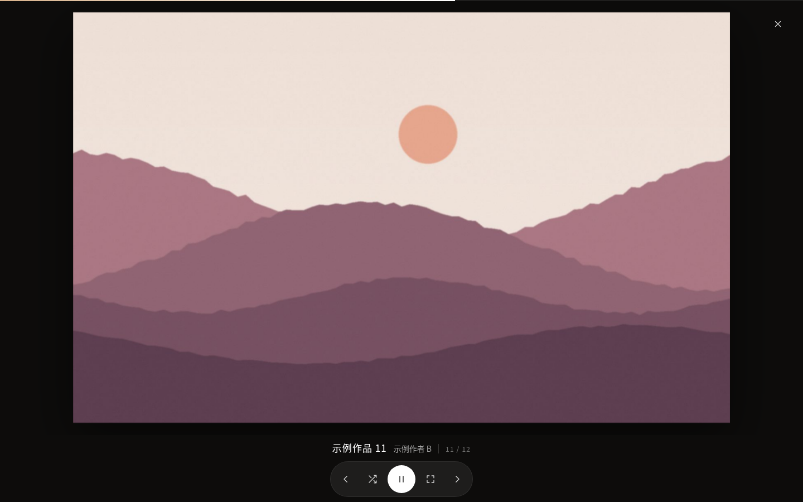
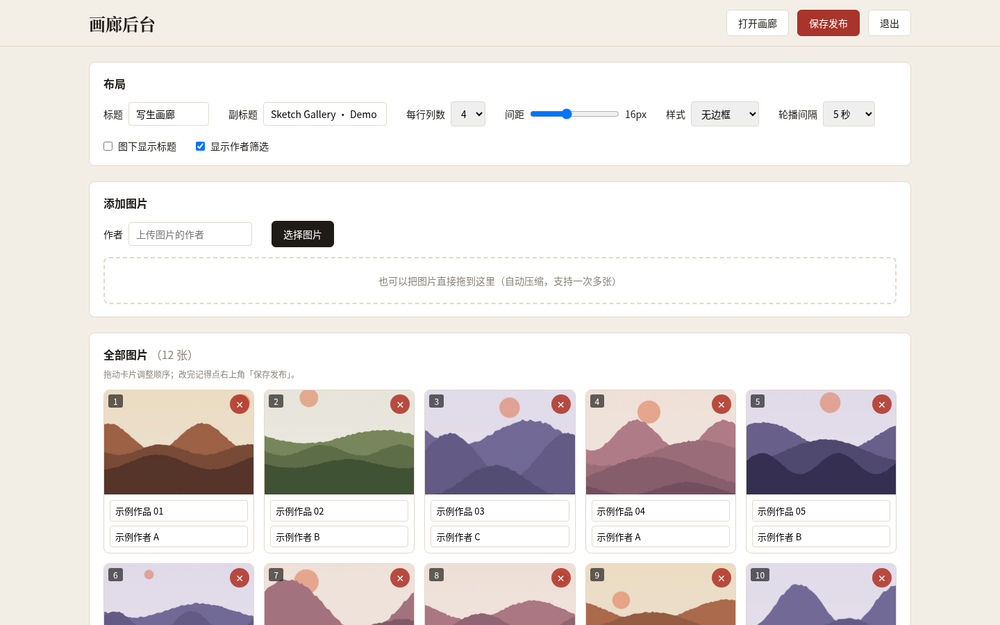

# 写生画廊 · Sketch Gallery

一个轻量、带密码保护的私人画廊：瀑布流浏览、全屏轮播、随机看图，外加一个可以增删图片、调整布局的管理后台。零前端依赖，后端只用 Python 标准库 + Nginx。

## 项目背景

这是我们小组「劳动法治教育」合作学习课题的一部分。组里五位美术专业的同学去温州楠溪江和江西婺源写生，画了一批国画和油画；我们三个计算机专业的同学负责把这些作品搬到线上——从设计、写代码到上线运维，都由我们三人分工完成，这也是我们在这个课题里交出的「技术劳动」。

课堂展示时，这个画廊作为线上展厅使用，通过密码访问，保护同学们作品的署名与版权。

> 出于对作者的尊重，仓库里不包含任何真实作品，所有图片均为程序生成的示例占位图。





## 功能

**画廊**
- 瀑布流布局，按作者筛选，懒加载缩略图
- 全屏查看器：淡入淡出切换、缓慢推近（Ken Burns）、进度条
- 轮播展示 / 随机一张；播放时控件自动隐藏
- 快捷键：`←` `→` 切换，`空格` 播放/暂停，`R` 随机，`F` 全屏，`Esc` 关闭

**后台 `/admin`**
- 批量上传（浏览器端自动压缩为 1800px 大图 + 640px 缩略图）
- 删除、编辑标题和作者、拖拽排序
- 布局设置：标题、副标题、列数、间距、边框样式、轮播间隔、标题显示、作者筛选
- 修改后台密码（加盐哈希存储）

**安全**
- 访客密码与管理员密码分离，HMAC 签名 Cookie（7 天）
- Nginx `auth_request` 保护全部图片与数据，未登录一律跳转登录页
- 登录失败限速

## 结构

```
www/            前端静态文件（index.html / app.js / admin / public）
  data.json     图片列表（后台保存时写入）
  settings.json 布局设置（后台保存时写入）
  img/ thumb/   大图 / 缩略图
server.py       登录 + 后台 API（Python 标准库，监听 127.0.0.1:8081）
deploy/         nginx.conf、systemd 服务、一键安装脚本
```

## 部署

```bash
git clone https://github.com/<you>/sketch-gallery.git
cd sketch-gallery
sudo bash deploy/install.sh
sudo nano /opt/gallery/.env      # 设置 GALLERY_PASSWORD / ADMIN_PASSWORD
sudo systemctl restart gallery
```

浏览 `http://<服务器IP>/`，后台 `http://<服务器IP>/admin`。重新运行安装脚本只会更新代码，不会覆盖后台里已改好的图片和设置。

## 本地预览前端

```bash
cd www && python3 -m http.server 8000
```

打开 http://localhost:8000 （本地预览不含登录与后台保存）。

## 开发者

由小组内三位计算机专业同学共同设计与开发。

## License

MIT
